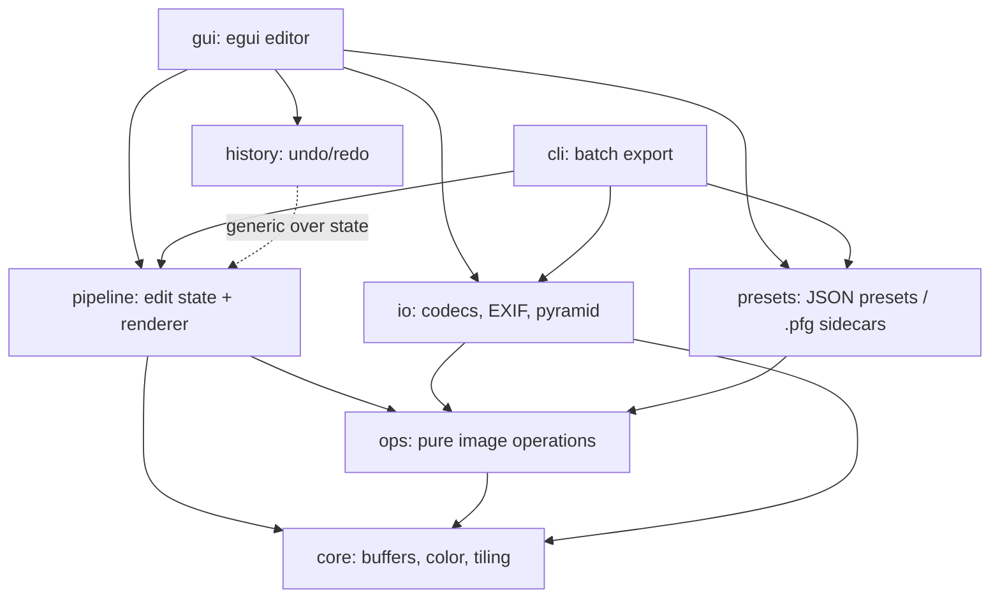

# photoforge Architecture

photoforge is a non-destructive photo editor. The persistent source of truth
for an edit is a small JSON description (the *edit state*), never the pixels:
original image files are read-only, and all adjustments are re-applied — from
the decoded original — whenever pixels are needed. This document describes how
the crates fit together, the color/processing model, the caching strategy and
the threading model. Design decisions and their rationale live in
[docs/adr/](adr/README.md).

## Crate layout

- **core** — `PixelBuffer` (u8 RGBA8 storage), `LinearImage` (f32 linear-light
  working space), color conversions (sRGB ↔ linear, HSV, OKLab), histograms,
  deterministic RNG and the row-band tile-parallel framework.
- **io** — decoding/encoding (via the `image` crate only), EXIF parsing and
  orientation auto-correction, mip-level image pyramids, thumbnails.
- **ops** — every adjustment as a pure function over `LinearImage` plus
  geometry operations over `PixelBuffer` (crop, rotate, flip, straighten,
  perspective, Lanczos3 resize). No I/O, no globals, fully unit-tested.
- **pipeline** — the non-destructive engine: an ordered adjustment stack
  (fixed global adjustments + user-added masked local adjustments), mask
  rasterization and blending, per-stage caches keyed by per-stage revisions,
  pyramid-level preview rendering and full-resolution export replay.
- **history** — generic command-pattern undo/redo with a memory budget and
  disk spill, plus snapshot ring and crash-recovery snapshots.
- **presets** — JSON preset files and `.pfg` sidecars (edit state stored next
  to the original image).
- **gui** — the egui/eframe dark-theme editor: canvas, adjustment panels,
  curve editor, crop overlay, mask tools, filmstrip, export dialog.
- **cli** — headless batch processing: apply a preset (+ sidecar if present)
  to a directory of images and export.

## Color model (ADR-0002)

- Storage format is 8-bit sRGB-encoded RGBA (`PixelBuffer`).
- All computation happens in a linear-light f32 working space
  (`LinearImage`): u8 → linear via an exact 256-entry decode table; linear →
  u8 via clamp + encode + round (u8↔f32 round-trip is bit-exact, enforced by
  tests).
- Tone sliders (exposure, contrast, highlights/shadows/whites/blacks, white
  balance, saturation/vibrance, HSL) operate on linear values.
  Tone *curves*, *levels* and *LUTs* operate on the sRGB-encoded value —
  that is what a curve editor's diagonal represents in every mainstream
  editor; the domain switch happens at the op boundary and is documented.
- Luminance is Rec. 709 luma computed on linear values.
- Perceptual work (saturation, vibrance) uses OKLab (Ottosson 2020).

## Execution and parallelism (ADR-0003)

- Pointwise adjustments are *fused*: consecutive unmasked pointwise ops run
  in a single pass over the pixels (one u8→f32 decode, one arithmetic chain,
  one encode). Masks and spatial ops (blur, sharpen, clarity, denoise) break
  fusion chains.
- Parallelism is row-band tiling with halo via rayon: the image is split into
  horizontal bands; each band reads its input rows plus a halo margin from
  the source buffer and writes only its own output rows — no unsafe, no
  aliasing, cache-friendly. Separable filters use row passes and column-group
  passes.
- Preview rendering picks a mip pyramid level so the rendered pixel count is
  close to the on-screen pixel count; interaction uses one level coarser
  (draft) and refines when idle.

## Caching (ADR-0004)

- `io::ImagePyramid` caches downsampled levels of the *original* (immutable).
- `pipeline` caches the result of each stage prefix per pyramid level. Every
  adjustment carries a revision counter; a cached stage is valid iff the
  revision vector of its prefix matches the current state — edits to stage *k*
  only invalidate stages ≥ *k*. Cache memory is bounded (LRU, byte budget).
- Mask rasters are cached per (mask revision, resolution).
- History never stores pixels; it stores parameter diffs plus occasional
  full-state JSON snapshots (memory-capped, disk spill).

## Threading (GUI)

The UI thread never processes pixels. It sends an `Arc<EditState>` render
request (revision-tagged, coalesced) to a worker thread that owns the stage
caches, renders the requested pyramid level + region, computes the histogram,
and sends back a frame. During slider drags the worker renders a coarser
level for latency, then a full-quality frame when interaction stops. Full-size
export runs on a second worker with progress messages.

## Non-goals / future work

GPU compute (wgpu) and RAW decoding (`rawler`) are explicitly deferred until
all core milestones are done (user requirement).
